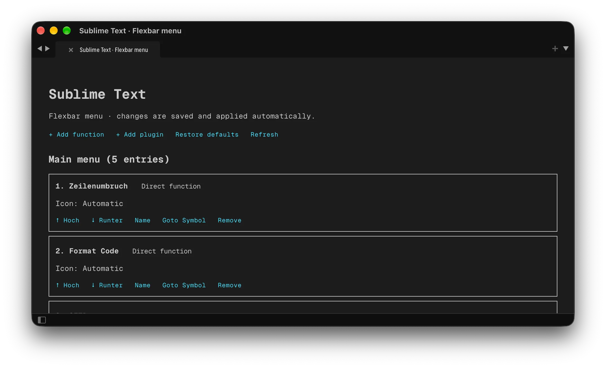

# FlexbarSublime-Sublime

Sublime-Text-4-Bridge, mit der Sublime Text über FlexDesigner von einer Flexbar aus gesteuert werden
kann.



Dieses Repository enthält den Sublime-Text-Teil des Projekts. Das zugehörige FlexDesigner-Plugin liegt
in [FlexbarSublime-Flexbar](https://github.com/Teddielike/FlexbarSublime-Flexbar).

## Voraussetzungen

- Sublime Text 4
- FlexDesigner 2.2.5 oder neuer
- macOS 10.15 oder neuer oder Windows 10 oder neuer
- `zip` zum Erstellen des Packages

## Build und Installation

```bash
./build.sh
```

Das erzeugte `FlexbarBridge.sublime-package` nach folgendem Ordner kopieren:

```text
~/Library/Application Support/Sublime Text/Installed Packages/
```

Unter Windows den entsprechenden `Installed Packages`-Ordner von Sublime Text verwenden. Sublime Text
nach der Installation neu starten. Das Package-Archiv und einen entpackten `FlexbarBridge`-Ordner nicht
gleichzeitig installieren.

## Funktionen

- konfigurierbare Sublime-Text-Befehle und Plugin-Untermenüs;
- adaptive Aktualisierung bei Änderungen von View, Auswahl oder Syntax;
- automatische und manuelle Material-Design-Symbole;
- deutsche und englische Benutzeroberfläche;
- lokale, authentifizierte HTTP-Bridge auf `127.0.0.1`;
- Status- und Verbindungsdiagnose in Sublime Text.

Im Command Palette **Sublime Text: Flexbar menu** öffnen, um die Tasten zu konfigurieren. Sprache und
Verbindung werden in `Packages/User/FlexbarBridge.sublime-settings` gespeichert.

## Tests

```bash
python3 -m unittest discover -s tests -p 'test_bridge.py'
```

## Lizenz

Copyright © 2026 Christian Sperber. Lizenziert unter der [MIT-Lizenz](LICENSE).
