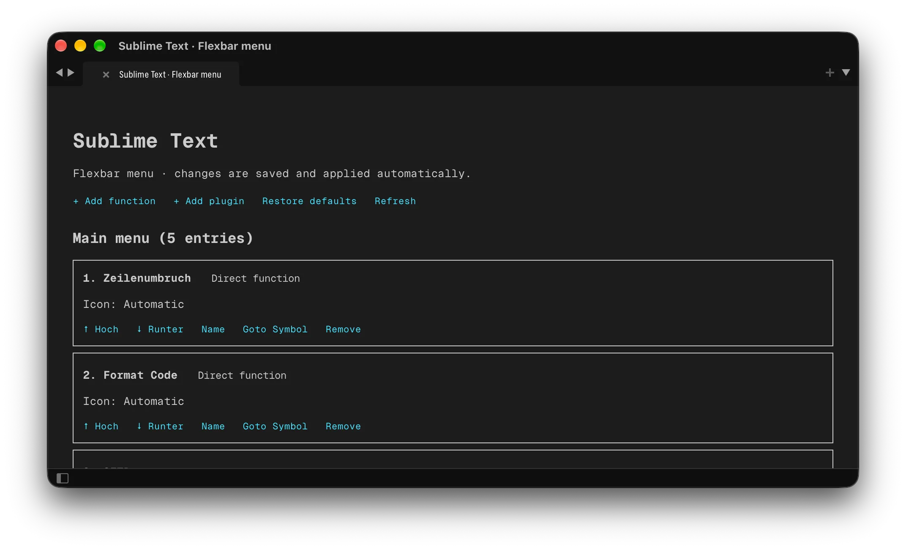

# FlexbarSublime-Bridge – Version 1.0.0

Sublime Text 4 bridge for controlling Sublime Text from a Flexbar through FlexDesigner.

This repository is the Sublime Text bridge component of the project. The companion FlexDesigner plugin is
available at [FlexbarSublime-Flexbar](https://github.com/Teddielike/FlexbarSublime-Flexbar).



## Requirements

- Sublime Text 4
- FlexDesigner 2.2.5 or newer
- macOS 10.15 or newer, or Windows 10 or newer
- `zip` for packaging

## Build and install

```bash
./build.sh
```

Copy the resulting `FlexbarBridge.sublime-package` to:

```text
~/Library/Application Support/Sublime Text/Installed Packages/
```

On Windows, use Sublime Text's `Installed Packages` directory. Restart Sublime Text after installation.
Do not install the package archive and an unpacked copy of the package at the same time.

## Features

- configurable Sublime Text commands and package submenus;
- adaptive menu updates when the active view, selection or syntax changes;
- automatic and manual Material Design icons;
- German and English user interface;
- local authenticated HTTP bridge on `127.0.0.1`;
- status and connection diagnostics in Sublime Text.

Open **Sublime Text: Flexbar menu** from the Command Palette to configure the keys. Language and
connection settings are stored in `Packages/User/FlexbarBridge.sublime-settings`.

## Tests

```bash
python3 -m unittest discover -s tests -p 'test_bridge.py'
```

## License

Copyright © 2026 Christian Sperber. Licensed under the [MIT License](LICENSE).
